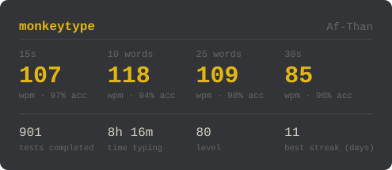

  

  

### 🚀 About Me

Full-stack developer passionate about building scalable MERN applications and clean system designs. I love turning complex ideas into smooth, user-friendly digital experiences.

🔭 &nbsp;I'm currently working on **a real-time chat application with MERN stack &amp; WebSockets**  
🌱 &nbsp;I'm currently learning **System Design principles and High-Availability Architecture**  
👯 &nbsp;I'm looking to collaborate on **Full-stack MERN projects and open-source web apps**  
💬 &nbsp;Ask me about **React, Node.js, Express, MongoDB, and System Design**  
😄 &nbsp;Pronouns: **he/him**

### 🛠️ Tech Stack

  
  
  
  
  
  
  
  
  
  
  
  
  
  
  
  
  
  
  
  
  
  
  
  
  
  
  
  
  
  
  
  

### ⌨️ Typing Stats

  

### 🔗 Connect With Me

  
  
  
  

### 💭 Dev Quote

  

---

<i>⭐️ From <a href="https://github.com/Af-Than">Af-Than</a></i>

